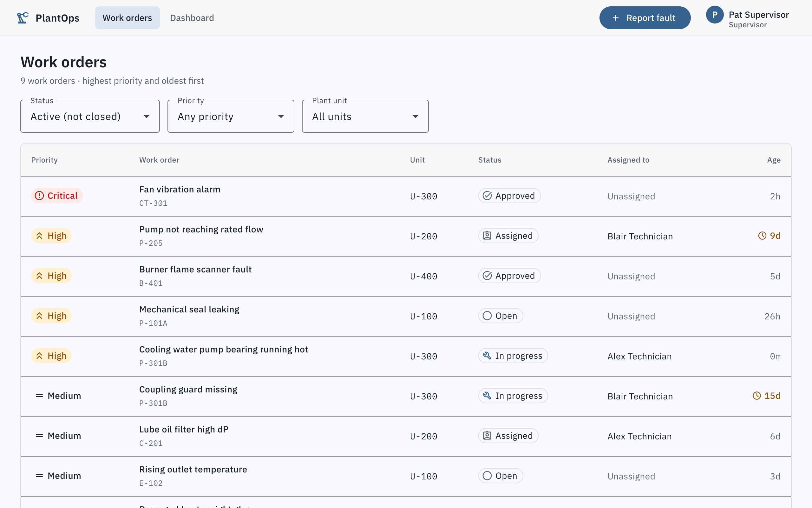
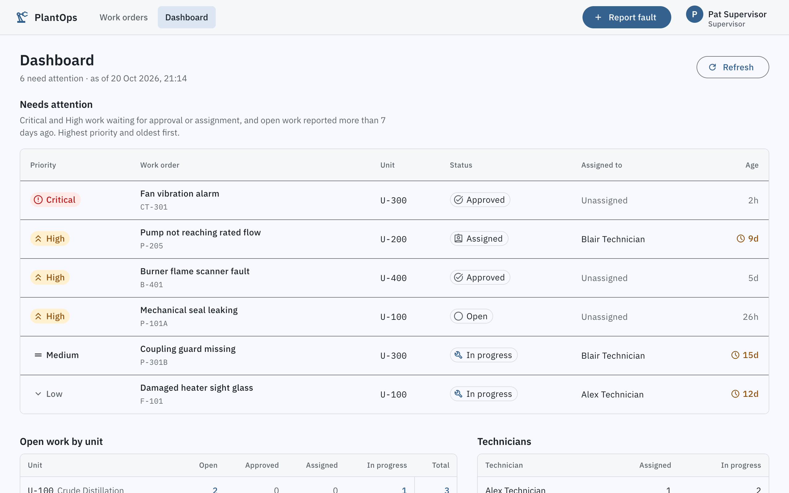
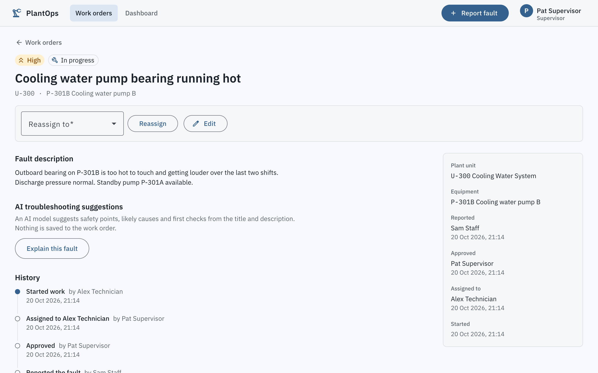
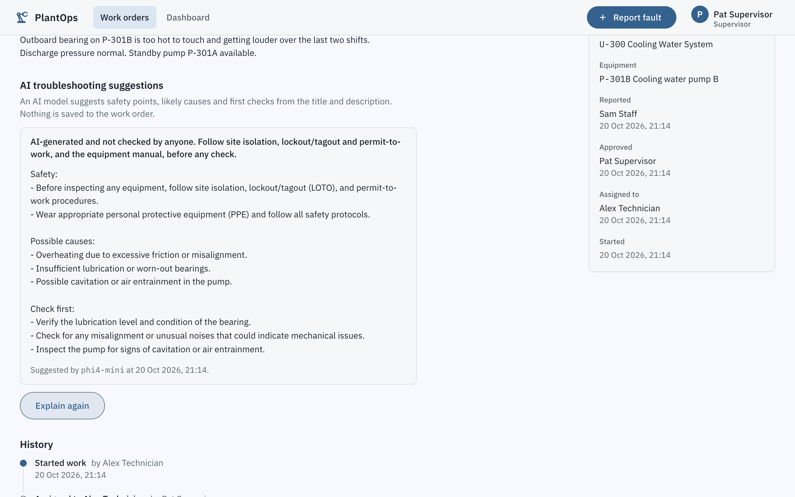
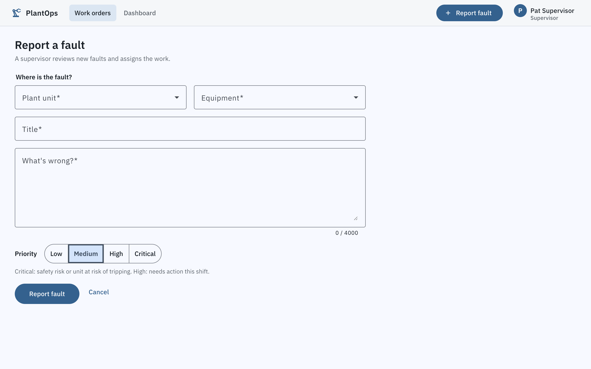
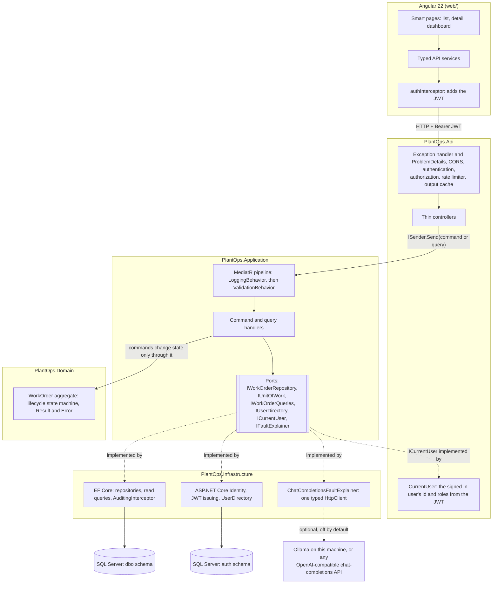

# PlantOps

Equipment maintenance work-order tracker. Plant staff log equipment faults, supervisors approve them and
assign work orders to technicians, technicians work and close them, and every change to a work order is audited.

## Screenshots

| | |
| --- | --- |
|  |  |
| **The queue.** Highest priority and oldest first. Colour only on Critical and High priority and on work older than 7 days. | **Dashboard** (Supervisor, Admin). What needs attention now, open work per unit and each technician's load. Each count in the unit table links to the rows behind it. |
|  |  |
| **Detail.** Only the actions this user may take, the who-and-when facts, and the full change history. | **Explain this fault** (optional, off by default). Suggestions from a model running locally, shown as plain text and marked as unchecked. |
|  | |
| **Report a fault.** Unit, equipment, priority, title and description. | |

## Architecture



Dependencies point inward: Api and Infrastructure depend on Application, Application on Domain, Domain on nothing.
Only `Program.cs` references Infrastructure, to register it. `tests/PlantOps.ArchitectureTests` fails the build if any
of that stops being true.

One request end to end, a supervisor approving a work order:

1. The detail page calls `WorkOrdersApi.approve(id)`; `authInterceptor` adds the JWT because the URL is the PlantOps API.
2. Middleware runs in order: exception handler, CORS, authentication (validates the token), authorization (the
   `ManageWorkOrders` policy: Supervisor or Admin), rate limiter, output cache.
3. `WorkOrdersController.Approve` sends `ApproveWorkOrderCommand` through MediatR's `ISender`.
4. `LoggingBehavior` records the name, outcome and duration; `ValidationBehavior` runs the FluentValidation rules, so
   invalid input comes back as a 400 without reaching the handler.
5. The handler loads the `WorkOrder` aggregate through `IWorkOrderRepository`, calls `workOrder.Approve(...)` (the
   state machine refuses an out-of-order step with a `Result` error, which becomes 409) and commits with
   `IUnitOfWork.SaveChangesAsync`.
6. EF Core saves the change and the `AuditingInterceptor` writes the audit row in the same transaction.
7. The controller returns `204 No Content`, and `[EvictDashboardCache]` drops the cached dashboard, so the next
   dashboard request is recomputed and shows the approval. (A dashboard that was already being computed while the
   approval committed can still be stored just after; the 60-second expiry bounds that.)

### Where each pattern lives

| Pattern | Where | Why |
| --- | --- | --- |
| Clean Architecture | `src/PlantOps.Domain`, `.Application`, `.Infrastructure`, `.Api`; rules in `tests/PlantOps.ArchitectureTests` | Business rules don't depend on EF Core, ASP.NET Core or the identity provider, and tests enforce it |
| CQRS with MediatR | `Application/WorkOrders/Commands/*`, `Application/WorkOrders/Queries/*`, `Abstractions/Messaging/ICommand.cs`, `IQuery.cs`; reads in `Infrastructure/Persistence/Queries/WorkOrderQueries.cs` | Writes go through the aggregate; reads project straight into DTOs with no tracking |
| Validation and logging behaviors | `Application/Behaviors/ValidationBehavior.cs`, `LoggingBehavior.cs`, registered in `Application/DependencyInjection.cs` | Cross-cutting steps written once and run for every request, in a fixed order |
| FluentValidation | A `*Validator` next to each command and query that takes input, e.g. `Commands/CreateWorkOrder.cs`. Requests with no input (`GetDashboardQuery`, `GetFeaturesQuery`, `ListPlantUnitsQuery`) have none, and `ValidationBehavior` passes them through | One place for field rules and messages; failures become `400` with per-field errors |
| Repository and Unit of Work | `Abstractions/Persistence/IWorkOrderRepository.cs`, `IUnitOfWork.cs`; `Infrastructure/Persistence/Repositories/*`, `PlantOpsDbContext.cs` | Handlers never see EF Core; one `SaveChangesAsync` commits a whole use case |
| Dependency injection | `Api/Program.cs` (composition root), `AddApplication`, `AddInfrastructure`, `AddIdentityAuthentication` | Lifetimes chosen on purpose: scoped DbContext per request, singleton `TimeProvider`, typed `HttpClient` |
| Result pattern and ProblemDetails | `Domain/Common/Result.cs`, `Error.cs`; `Api/Controllers/ApiControllerBase.cs`; `Api/ErrorHandling/GlobalExceptionHandler.cs` | Expected failures are values mapped to RFC 7807 (400, 403, 404, 409, 503); exceptions are for bugs |
| Options pattern | `Infrastructure/Identity/JwtOptions.cs`, `Infrastructure/Ai/AiOptions.cs`, `Api/Configuration/RateLimitingSettings.cs` | Typed settings, validated at startup, so bad configuration stops the app instead of failing later |
| DDD aggregate with an enforced lifecycle | `Domain/WorkOrders/WorkOrder.cs` (`AllowedTransitions`), `WorkOrderErrors.cs` | Private setters and one transition table: Open, Approved, Assigned, In progress, Closed can't be skipped |
| Ports and adapters | `Abstractions/Authentication/IUserDirectory.cs`, `Abstractions/Ai/IFaultExplainer.cs`; `Infrastructure/Identity/UserDirectory.cs`, `Infrastructure/Ai/ChatCompletionsFaultExplainer.cs` | Swapping the identity provider or the AI provider touches one adapter or only configuration |
| Output caching | `Api/Caching/*`, `Controllers/DashboardController.cs`, order in `Program.cs` | One shared dashboard copy for at most 60 seconds, evicted on every work-order or account change |
| Smart and presentational components | Smart: `*-page.ts`. Presentational: `work-order-table.ts`, `work-order-action-bar.ts`, `unit-workload-table.ts`, `fault-explanation.ts` | Pages own data and events; the rest only take inputs and emit outputs, so they are simple to test |
| HTTP interceptor | `web/src/app/core/auth/auth-interceptor.ts` | Adds the token only to PlantOps API calls; signs out on a `401` |
| Role guards | `web/src/app/core/auth/auth-guards.ts`, used in `app.routes.ts` (`roleGuard('Admin')`, `roleGuard('Supervisor', 'Admin')`) | Navigation convenience; the API enforces the same rules with named policies |

## Tech stack

| Area | Choice |
| --- | --- |
| API | .NET 10 (LTS), ASP.NET Core Web API, C# |
| Data | Entity Framework Core 10, SQL Server 2022 (Docker locally, Azure SQL in the cloud) |
| Auth | ASP.NET Core Identity, JWT bearer tokens, role-based policies |
| Front end | Angular 22 (standalone components, signals, zoneless), Angular Material 3, RxJS, typed reactive forms |
| AI (optional) | Any OpenAI-compatible chat-completions API through one typed `HttpClient`; locally [Ollama](https://ollama.com) (MIT, offline, free) |

## Solution layout

```
PlantOps/
├── src/
│   ├── PlantOps.Domain/          Entities, WorkOrder aggregate, Result/Error. No dependencies.
│   ├── PlantOps.Application/     CQRS commands/queries, MediatR behaviors, validators. Depends on Domain.
│   ├── PlantOps.Infrastructure/  EF Core, repositories, read queries, audit interceptor, migrations, seed data.
│   │   ├── Identity/             ASP.NET Core Identity, JWT issuing, user directory (own DbContext, "auth" schema).
│   │   └── Ai/                   "Explain this fault" adapter for OpenAI-compatible APIs (optional).
│   └── PlantOps.Api/             Controllers, ProblemDetails, output caching, OpenAPI, composition root, Dockerfile.
├── tests/                        Unit, integration and architecture tests (see "Testing" below).
├── docs/                         Screenshots and the query-plan check script.
├── web/                          Angular front end (see "Front end" below), Dockerfile and nginx config.
├── .config/dotnet-tools.json     Pinned .NET tools (ReportGenerator).
├── .github/                      CI workflow and Dependabot config.
├── infra/                        Azure infrastructure (Bicep), the one-time setup runbook and SQL grants.
├── PRODUCT.md                    Who the UI is for and the design principles it follows.
├── .node-version                 Node 24 for this repo (read by fnm and by CI).
├── Directory.Build.props         Shared compiler settings for every project
├── Directory.Packages.props      Central NuGet versions
├── docker-compose.yml            SQL Server, API and web app in containers
└── global.json                   Pins the .NET SDK
```

Dependencies point inward: `Api → Application → Domain`, and `Infrastructure → Application`.
The Api project references Infrastructure only to register its services at startup.

## Getting started

Prerequisites: .NET 10 SDK, Docker Desktop (on Apple Silicon, keep "Use Rosetta for x86/amd64 emulation" on),
the EF Core CLI (pinned in `.config/dotnet-tools.json`: run `dotnet tool restore`), and Node 24 for the front end. With
[fnm](https://github.com/Schniz/fnm), `fnm install` in this folder picks the version from `.node-version`.

1. Create your local secrets file and choose a strong SQL Server password:

   ```bash
   cp .env.example .env
   ```

2. Start SQL Server and wait until it reports `healthy`:

   ```bash
   docker compose up -d sqlserver
   docker compose ps
   ```

3. Store the secrets in user-secrets (kept outside the repo, loaded only in Development): the connection string,
   the key that signs JWTs, and the password the demo accounts will share (10+ characters with upper and lower
   case, a digit and a symbol):

   ```bash
   set -a; source .env; set +a
   dotnet user-secrets set "ConnectionStrings:PlantOps" "Server=localhost,${SQL_PORT};Database=PlantOps;User Id=sa;Password=${MSSQL_SA_PASSWORD};Encrypt=True;TrustServerCertificate=True" --project src/PlantOps.Api
   dotnet user-secrets set "Jwt:SigningKey" "$(openssl rand -base64 48)" --project src/PlantOps.Api
   dotnet user-secrets set "Seed:DemoUserPassword" "<your demo password>" --project src/PlantOps.Api
   ```

   Forgot the demo password? `dotnet user-secrets list --project src/PlantOps.Api` shows it.

4. Create the database. There are two DbContexts, business data and Identity, so there are two migration sets:

   ```bash
   dotnet ef database update --context AuthDbContext --project src/PlantOps.Infrastructure --startup-project src/PlantOps.Api
   dotnet ef database update --context PlantOpsDbContext --project src/PlantOps.Infrastructure --startup-project src/PlantOps.Api
   ```

5. Run the API. In Development it also applies migrations and creates the demo accounts and sample work orders:

   ```bash
   dotnet run --project src/PlantOps.Api --launch-profile http
   ```

   Swagger UI is at http://localhost:5297/swagger (the raw OpenAPI document is at `/openapi/v1.json`).

6. Run the web app in a second terminal, then open http://localhost:4200 and sign in with a demo account:

   ```bash
   cd web
   npm install
   npm start
   ```

### Optional: "Explain this fault" with a local model

The feature is off by default; when it is off the button doesn't appear and the endpoint answers 404. To try it with
[Ollama](https://ollama.com) (MIT licence, runs offline, macOS 14 or later):

```bash
brew install ollama && brew services start ollama
ollama pull phi4-mini        # 2.5 GB download, MIT licence
dotnet user-secrets set "Ai:Enabled" "true" --project src/PlantOps.Api
```

Restart the API. The defaults (`Ai:BaseUrl` `http://localhost:11434/v1/`, `Ai:Model` `phi4-mini`) point at Ollama. The
first answer after a pause is slower, because Ollama loads the model into memory first; the API waits up to 60 seconds
(`Ai:TimeoutSeconds`). On the MacBook Air this was built on, phi4-mini answered in about 5 seconds, and in about 15 for
the first request while the model loaded. Ollama listens on `127.0.0.1` only; `OLLAMA_NO_CLOUD=1` keeps it from using Ollama's hosted
models.

The provider is configuration only: any server that implements the OpenAI chat-completions API works. A hosted one
needs `Ai:BaseUrl`, `Ai:Model` and an `Ai:ApiKey` (a secret: user-secrets, never appsettings.json). Check its terms
first: free tiers usually need an account, limit requests and may log prompts, so send demo data only. (GitHub Models
was the original plan here; GitHub retired it on 30 July 2026, and moving off it is exactly the configuration change
above.)

In Docker, set `AI_ENABLED=true` in `.env`. With Docker Desktop on macOS the API container reaches Ollama on the host
as `host.docker.internal`, even though Ollama listens on `127.0.0.1` only. On Docker Engine for Linux that name points
at the bridge gateway instead, so Ollama must also listen there (`OLLAMA_HOST`), which exposes it beyond this machine
unless a firewall blocks port 11434. For a hosted provider, set `AI_BASE_URL`, `AI_MODEL` and `AI_API_KEY` in `.env`.

### Or run the whole stack in Docker

No .NET SDK or Node needed, only Docker. Fill in all four values in `.env` (`JWT_SIGNING_KEY` from
`openssl rand -hex 32`, and a `DEMO_USER_PASSWORD` for the demo accounts), then:

```bash
docker compose up -d --build
```

Open http://localhost:8081 for the web app. The API is at http://localhost:8080 (Swagger UI at `/swagger`, health
at `/health`). The API container runs as Development, so it applies migrations and creates the demo accounts with
`DEMO_USER_PASSWORD`. Both setups use the same database volume; the demo accounts take the password of whichever
setup started last. The web container is nginx serving the production Angular build. It writes `/config.json`
from its `API_BASE_URL` and `SHOW_DEMO_ACCOUNTS` variables when it starts, so the same image works in any
environment. Both images run as non-root users. `docker compose down` stops everything and keeps the data.

### Trying the API in Swagger UI

Demo accounts, all sharing one password: locally your `Seed:DemoUserPassword`; when deployed to Azure, the
password shown on the login page. The deployed demo has every account below except Admin.

| Email | Name | Role |
| --- | --- | --- |
| `staff@plantops.test` | Sam Staff | Staff |
| `supervisor@plantops.test` | Pat Supervisor | Supervisor |
| `tech.a@plantops.test` | Alex Technician | Technician |
| `tech.b@plantops.test` | Blair Technician | Technician |
| `admin@plantops.test` | Ada Admin | Admin |

To act as someone: call `POST /api/auth/login`, copy `accessToken` from the response, click **Authorize** and
paste it. Then try a full lifecycle:

1. As staff: `GET /api/plant-units` to pick an equipment id, then `POST /api/work-orders`.
2. As supervisor: `POST /api/work-orders/{id}/approve`, then `GET /api/users?role=Technician` and
   `POST /api/work-orders/{id}/assign` with a technician's id.
3. As that technician: `POST /api/work-orders/{id}/start`, then `/close` with resolution notes.
4. As anyone: `GET /api/work-orders/{id}/history` shows every change, who made it and when.

Out-of-order steps return `409 Conflict`, a missing permission or the wrong technician gets `403 Forbidden`, and
invalid input gets `400` with per-field errors, all as RFC 7807 problem details.

`TrustServerCertificate=True` is only for the local container's self-signed certificate. Azure SQL uses a
trusted certificate, so deployed environments do not set it.

### Adding a migration

```bash
dotnet ef migrations add <Name> --context PlantOpsDbContext --project src/PlantOps.Infrastructure --startup-project src/PlantOps.Api --output-dir Persistence/Migrations
```

For Identity schema changes use `--context AuthDbContext --output-dir Identity/Migrations`.

## Front end

Angular 22 with standalone components, signals and zoneless change detection, Angular Material 3, RxJS and typed
reactive forms. Design intent and principles are in [PRODUCT.md](PRODUCT.md): calm and neutral by default, with
colour reserved for Critical/High priority, ageing work and errors.

```
web/src/app/
├── core/
│   ├── auth/            AuthStore (signals), JWT interceptor, route guards
│   ├── layout/          Shell: top bar, navigation, user menu
│   └── problem-details  RFC 7807 helpers, incl. mapping API field errors onto form controls
├── shared/              Priority and status badges, time helpers
└── features/
    ├── login/
    ├── work-orders/     list (filters, table), detail (action bar, facts, history, explain), form (create, edit)
    ├── dashboard/       Supervisor and Admin overview: needs attention, open work per unit, technician load
    └── users/           Admin-only account management
```

- **Smart and presentational components**: pages (`*-page.ts`) inject services, load data and handle events;
  tables, forms, badges and the action bar only take inputs and emit outputs.
- **State**: signals for UI state, RxJS for streams. The list's filters live in the URL query string (shareable,
  back button works), and `switchMap` cancels stale requests when filters change quickly.
- **Auth**: the JWT is kept in `sessionStorage`: per tab and survives a refresh, but browsers restore it when a
  closed tab is reopened, so on shared PCs people use Sign out (the token itself expires within 60 minutes). Expiry
  is timed from the login response's `expiresInSeconds` on the device's own clock. The interceptor adds the token
  only to requests for the PlantOps API, and signs the user out on a `401`. An HttpOnly cookie set by a
  backend-for-frontend would protect the token from XSS better; that is the next step if the threat model needs it.
- **Runtime config**: before bootstrapping, `main.ts` fetches `/config.json` (the API URL and whether to list demo
  accounts) and provides it through DI. Locally that is `web/public/config.json`; the nginx container writes it from
  environment variables. One build runs in every environment, with no rebuild per environment.
- **Guards**: `authGuard`, `roleGuard('Admin')`, `roleGuard('Supervisor', 'Admin')` and `guestGuard` decide
  navigation. They are convenience only; the API enforces every rule, and `availableActions()` mirrors those rules
  just to hide buttons that would fail.
- **Optional features**: the web app asks `GET /api/features` whether "Explain this fault" is switched on, so there is
  one switch, in the API. The answer is rendered only through interpolation (escaped text), never as HTML.
- **Every view handles loading, error and empty states**: skeletons while loading, a retry on errors, and empty
  states that say what to do next.
- **Accessibility**: WCAG 2.2 AA target; axe-core reports no violations on any screen. Status and priority are
  never colour alone, focus is always visible, and there is a skip link.

## Performance

| Requirement | How | Where |
| --- | --- | --- |
| Pagination | `OFFSET/FETCH` with a stable order (priority, age, then id), page size at most 100, page number capped so the offset can't overflow | `ListWorkOrders.cs`, `WorkOrderQueries.ListAsync` |
| No tracking on reads | Read queries use `AsNoTracking` and project straight into DTOs, so only the needed columns are read and nothing is change-tracked; only the command side loads tracked aggregates | `Infrastructure/Persistence/Queries/*`, `UserDirectory.cs`, `WorkOrderRepository.cs` |
| Index on status and unit | `IX_WorkOrders_Status_PlantUnitId` (migration `AddWorkOrderStatusIndex`); `IX_WorkOrders_PlantUnitId` already existed as the foreign-key index | `WorkOrderConfiguration.cs` |
| Dashboard response caching | Output caching: the whole response is kept in memory for at most 60 seconds and evicted on any work-order or account change | `Api/Caching/*`, `DashboardController.cs` |

At demo size (ten work orders) SQL Server scans the table whatever the indexes are, so the index was checked on
100,000 synthetic rows, 97% of them closed, with [`docs/perf/plan-check.sql`](docs/perf/plan-check.sql). It must run
against a throwaway database; it prints each query's plan and reads:

```bash
set -a; source .env; set +a
dotnet ef database update --context PlantOpsDbContext --project src/PlantOps.Infrastructure --startup-project src/PlantOps.Api \
  --connection "Server=localhost,${SQL_PORT};Database=PlantOpsPerf;User Id=sa;Password=${MSSQL_SA_PASSWORD};Encrypt=True;TrustServerCertificate=True"
docker exec -i -e SQLCMDPASSWORD="$MSSQL_SA_PASSWORD" plantops-sql /opt/mssql-tools18/bin/sqlcmd -S localhost -U sa -C -d PlantOpsPerf -W < docs/perf/plan-check.sql
docker exec -e SQLCMDPASSWORD="$MSSQL_SA_PASSWORD" plantops-sql /opt/mssql-tools18/bin/sqlcmd -S localhost -U sa -C -Q "DROP DATABASE PlantOpsPerf"
```

Measured on those 100,000 rows (SQL Server logical reads, lower is better):

| Query | Without the index | With `IX_WorkOrders_Status_PlantUnitId` |
| --- | ---: | ---: |
| List: count of active work orders | 15,148 (full scan) | 45 |
| List: count for one status (`?status=Open`) | 15,148 (full scan) | 12 |
| List: page 1 of active work | 15,148 (full scan) | 9,253 |
| Dashboard: open work per unit and status | 60,592 (four full scans) | 168 |
| Dashboard: work held per technician | 15,148 (full scan) | 3,089 |
| Dashboard: needs attention, count | 15,148 (full scan) | 9,241 |
| Dashboard: needs attention, top 25 | 15,148 (full scan) | 9,253 |

The status and per-unit counts become index-only seeks. The other queries still look up every active row in the
table (key lookups), because the columns they need besides status and unit (priority, creation time, assignee, title)
are not in the index. Removing those lookups would take an index that carries all of them; it was left out, because
every write would maintain that wider index, for a list that holds a few hundred active rows at plant scale. In
Development the API logs every SQL statement it sends (`Microsoft.EntityFrameworkCore.Database.Command`), which is the
quickest way to check a page's query count.

## Testing

| Project | Kind | What it proves |
| --- | --- | --- |
| `tests/PlantOps.Domain.UnitTests` | Unit | The `WorkOrder` state machine (every from/to pair), invariants, the Result type |
| `tests/PlantOps.Application.UnitTests` | Unit | Handlers with mocked ports (Moq) and a fake clock; validators; the validation pipeline behavior |
| `tests/PlantOps.Api.IntegrationTests` | Integration | The real API over HTTP against a real SQL Server in Docker: auth, policies, lifecycle, audit, concurrency, ProblemDetails, CORS, rate limiting, demo seeding and the first-Admin command (each on its own database); the dashboard's selection and counts, its output cache and eviction, and that no other role gets the cached copy; "Explain this fault" with a fake model, and the chat-completions adapter against a stub HTTP handler; the dashboard cache policy's storage rule as a unit test |
| `tests/PlantOps.ArchitectureTests` | Architecture | The Clean Architecture rules as tests: Domain depends on nothing, Application has no EF Core or ASP.NET Core, handlers are sealed and internal, and the cached dashboard's handler can't read the current user |
| `web/src/**/*.spec.ts` | Front-end unit | `availableActions`, the JWT interceptor, the guards, ProblemDetails mapping, the navigation per role, the dashboard page (including a failed refresh) and its unit table, the explain panel (plain-text rendering, one request at a time) and the detail page's back link |

Stack: xUnit v3 on Microsoft Testing Platform (opted in via `global.json`), FluentAssertions 7 (the last
Apache-2.0 line), Moq, `FakeTimeProvider`, and for integration tests `WebApplicationFactory`, Testcontainers and
Respawn. The integration fixture starts one SQL Server container per run, applies both migration sets, creates one
user per role, and Respawn clears work orders and audit rows before each test. Tests about timestamps run against a
second in-memory API with a fake clock, so nothing depends on the machine clock.

Run everything (Docker must be running for the integration tests):

```bash
dotnet test
```

Front-end tests:

```bash
cd web && npm test
```

Coverage (coverlet plus ReportGenerator, pinned in `.config/dotnet-tools.json`; run `dotnet tool restore` once):

```bash
dotnet test --results-directory TestResults --coverlet --coverlet-output-format cobertura --coverlet-include "[PlantOps.*]*" --coverlet-exclude-by-file "**/Migrations/*.cs"
```

```bash
dotnet reportgenerator -reports:"TestResults/**/*.cobertura*.xml" -targetdir:coverage-report -reporttypes:"Html;TextSummary"
```

## Continuous integration

[`.github/workflows/ci.yml`](.github/workflows/ci.yml) runs on every push to `main` and every pull request. Three
check jobs run in parallel; on `main`, two deploy jobs follow once deployment is switched on (see Deployment):

| Job | What it checks |
| --- | --- |
| Backend | Release build (warnings are errors), all four test projects including the Testcontainers integration tests, a coverage report in the run summary (HTML as an artifact), a minimum of 80% line coverage, and no known-vulnerable NuGet packages |
| Frontend | `npm ci`, the Vitest suite, the production build (with its bundle budgets), and `npm audit` on runtime dependencies |
| Docker images | Both images build, and the web image serves `/config.json` from its environment variables with the security headers |
| Deploy to Azure (main only) | After the three jobs pass: migrations and demo seed only when a migration or the seed code changed, the tested API build to App Service, then API smoke tests |
| Deploy front end (main only) | After the API deploy: the tested web build and its config.json to Static Web Apps, in a job with no Azure credentials, then front-end smoke tests |

The workflow is read-only by default (only the deploy job may request an Azure token), cancels superseded runs
except on `main` (a deploy is never stopped half-way), and pins every action to a commit SHA.
[Dependabot](.github/dependabot.yml) opens grouped monthly PRs for actions, NuGet and npm (NuGet and npm: minor
and patch only; actions: every release).

## Deployment

PlantOps is built to run on Azure for Students at $0: the API on App Service F1 (Linux, .NET 10), the Angular build on
Static Web Apps Free, and Azure SQL's free serverless offer, which pauses rather than bills when the monthly allowance
runs out. The infrastructure is deploy-ready but not deployed: the deploy jobs stay switched off (CI shows them as
skipped) until the repository variable `AZURE_DEPLOY` is `true`, the last step of the setup. Azure Policy deny rules
make paid SKUs impossible to create. There are no database passwords (Entra-only SQL, managed identities) and no Azure
credentials in GitHub (OIDC). The only secret is the Static Web Apps deployment token. CI deploys exactly what it
tested; migrations run in the pipeline with their own identity, only when a migration or the seed code changed, and
the readiness check (`/health`) runs only on those deploys, so a routine deploy never wakes the free database. Only
`/health/live` is safe to monitor. Infrastructure and the one-time setup are in [infra/README.md](infra/README.md).

## Security model

CORS: only the origins in the `Cors:AllowedOrigins` setting may call the API from a browser (in Development,
`http://localhost:4200`), with only the methods and headers the web app uses.

Authentication: `POST /api/auth/login` checks the password with ASP.NET Core Identity and returns a JWT signed with
HMAC-SHA256, valid for 60 minutes. Every other endpoint except the two health checks requires a valid token (a
fallback policy, so new endpoints are protected by default). The health checks are anonymous for load balancers and
return only `Healthy` or `Unhealthy`; the one that queries the database has a rate limit shared by all clients. Five wrong passwords lock an account for 15 minutes (except the shared demo accounts: their password is public, so
lockout would only let visitors lock each other out), and login is
rate-limited per IP. Wrong email, wrong password and a locked account all return the same `401`, and an unknown
email still runs a password-hash check, so neither the response nor its timing reveals which accounts exist.

Authorization happens at two levels:

| Rule | Where | How |
| --- | --- | --- |
| Who may approve/assign, start/close, manage users | API | Named policies (`Policies.cs`) mapped to roles |
| Only the assigned technician may start/close | Domain | `WorkOrder.Start` / `Close` |
| Reporters may edit their own report, and only while it is Open | Application | `UpdateWorkOrderCommandHandler` |
| Assignee must be a technician | Application | `AssignWorkOrderCommandHandler` via `IUserDirectory` |

| Action | Staff | Supervisor | Technician | Admin |
| --- | :---: | :---: | :---: | :---: |
| View work orders and history | ✓ | ✓ | ✓ | ✓ |
| Explain a fault (when switched on) | ✓ | ✓ | ✓ | ✓ |
| View the dashboard | | ✓ | | ✓ |
| Report a fault | ✓ | ✓ | ✓ | ✓ |
| Edit a work order | own, while Open | ✓ | own, while Open | ✓ |
| Approve, assign | | ✓ | | ✓ |
| Start, close | | | assigned only | |
| List users | | ✓ (not Admins) | | ✓ |
| Create users | | | | ✓ |

Audit log: an EF Core `SaveChangesInterceptor` on the business `PlantOpsDbContext` writes an `AuditEntries` row
for every created, updated or deleted work order, plant unit or piece of equipment, with old and new values, the
user and the time, in the same transaction as the change. Accounts live in the separate Identity store, which the
interceptor deliberately never sees (no password hashes in the audit table); creating an account is instead
recorded as a structured security log event with the acting admin's id.

### Swapping to Microsoft Entra ID

Identity-specific code sits behind `AddIdentityAuthentication(...)` and the `IAccountService` / `IUserDirectory`
ports, and policies use role names that Entra app roles can match. The move is contained but not free:

1. Replace `AddIdentityAuthentication(...)` with Microsoft.Identity.Web's `AddMicrosoftIdentityWebApi(...)` and
   create Entra app roles named Staff, Supervisor, Technician and Admin.
2. Read the user id from Entra's `oid` claim in `CurrentUser`.
3. Implement `IUserDirectory` over Microsoft Graph.
4. Remove what Entra now owns: the login and create-user endpoints, their commands, `IAccountService`,
   `Infrastructure/Identity` and the demo-user seeding.
5. Run a one-off data migration: work orders and audit rows store Identity user ids, and Entra assigns its own
   object ids, so map each old id to the matching Entra `oid` (by email). Storing ids rather than foreign keys
   into the Identity tables keeps this to an `UPDATE`, not a schema change.

## API

| Method | Route | Purpose |
| --- | --- | --- |
| POST | `/api/auth/login` | Email and password in, JWT access token out (anonymous, rate-limited) |
| GET | `/api/users?role=` | List users, e.g. technicians to assign (Supervisor: every account except Admins; Admin: all) |
| POST | `/api/users` | Create an account with a role (Admin) |
| GET | `/api/work-orders?status=&activeOnly=&plantUnitId=&priority=&assignedToUserId=&page=&pageSize=` | Paged list, highest priority and oldest first |
| GET | `/api/work-orders/{id}` | Work order details, with user names |
| GET | `/api/work-orders/{id}/history` | Audit trail: every change, who and when |
| POST | `/api/work-orders` | Report a fault (starts as Open) |
| PUT | `/api/work-orders/{id}` | Edit title, description, priority (not when Closed; see rules above). Send back `version` from the GET; a stale version returns `409` |
| POST | `/api/work-orders/{id}/approve` | Open → Approved |
| POST | `/api/work-orders/{id}/assign` | Approved/Assigned/InProgress → Assigned (assign or hand over) |
| POST | `/api/work-orders/{id}/start` | Assigned → InProgress (assigned technician only) |
| POST | `/api/work-orders/{id}/close` | InProgress → Closed (assigned technician only) |
| GET | `/api/plant-units` | Plant units with their equipment |
| GET | `/api/dashboard` | Supervisor overview (Supervisor, Admin): needs attention, open work per unit, technician load. Cached for up to 60 seconds and dropped after any work-order or account change; `generatedAtUtc` says when it was computed |
| GET | `/api/features` | Which optional features are switched on (`explainFault`) |
| POST | `/api/work-orders/{id}/explanation` | AI troubleshooting suggestions as plain text, never saved. `404` when switched off, `503` when the model doesn't answer, 5 per minute per user |
| GET | `/health/live` | Liveness: the process is up, no dependencies (anonymous; Azure probes this) |
| GET | `/health` | Readiness: the API can reach the database (anonymous, rate-limited across all clients); each call resumes a paused serverless database, so monitor `/health/live` instead |

Work orders are never deleted: they are maintenance history, and Closed is the end of the lifecycle.

## Design Q&A

**The dashboard is cached, but every request carries a token. How is that safe, and why not `[ResponseCache]`?**
`[ResponseCache]` only sets HTTP headers, and the response-caching middleware never stores a request that has an
`Authorization` header, so it would do nothing here. Output caching keeps the finished response on the server. Its
built-in default policy refuses signed-in requests (and in some .NET 10 patch releases it also overrode later
policies that allow them: dotnet/aspnetcore#69386, fixed for 10.0.14), so the dashboard policy leaves it out and
`SharedResponseCachePolicy` owns every rule itself. It is safe because `UseOutputCache` runs after `UseAuthorization`:
a Staff or Technician request is refused with 403 before the cache is consulted, which an integration test proves by
priming the cache as a supervisor first; the response holds nothing about the caller, which an architecture test
enforces (the handler can't depend on `ICurrentUser`); and every successful work-order or account change evicts the
copy. The one gap is a race I found in review: a dashboard already being computed when a change commits is stored just
after the eviction, so it can be up to 60 seconds old. The expiry bounds that and the page shows its age; a
generation counter would close it, but wasn't worth the extra moving part for a dashboard.

**Why is "Explain this fault" a query sent with POST, and how do you change the AI provider?**
It changes nothing in PlantOps, so it is a MediatR `IQuery` and lives with the other queries. It goes over POST
because it is slow and rate-limited, so nothing should prefetch it or cache it on the way. The Application layer only
knows the `IFaultExplainer` port; `ChatCompletionsFaultExplainer` speaks the OpenAI chat-completions format that
Ollama and most hosted providers implement. The brief named GitHub Models, but GitHub retired it in July 2026, before
I built this feature, so the defaults point at Ollama and a hosted provider is documented as configuration only:
switching means changing `Ai:BaseUrl`, `Ai:Model` and `Ai:ApiKey`. The reporter's text is untrusted, so it goes inside
delimiter tags the system prompt tells the model never to obey, the tags are stripped from the text first, and the
answer is shown as escaped plain text with a note that nobody has checked it.

**How does the `WorkOrder` aggregate enforce its lifecycle, and which rules live elsewhere?**
All state lives behind private setters, and every change is a method (`Approve`, `Assign`, `Start`, `Close`) that
checks one transition table, `AllowedTransitions`, and returns a `Result` error for an out-of-order step, which the
API maps to 409. Rules that need only the aggregate's own data live there too, such as "only the assigned technician
may start or close". Rules that need other data live in handlers ("the assignee must be a technician" asks
`IUserDirectory`); rules that depend only on the role are named policies at the API.

**What did you do for performance, and how do you know the index helps?**
Paged reads with a stable order, `AsNoTracking` projections straight into DTOs (no N+1: names are fetched in one batch
per page), a composite index on `(Status, PlantUnitId)`, and output caching for the dashboard. With ten demo rows SQL
Server scans whatever you do, so I loaded 100,000 synthetic rows and compared plans with and without the index
(`docs/perf/plan-check.sql`): the status filters and the dashboard's per-unit counts switch from a full scan to an
index seek. The "needs attention" filter was (High and waiting) OR (open and old), with the status test inside one
branch, so SQL Server had nothing to seek on. Every row it wants is open, so I pulled `Status <> Closed` out as a
top-level AND (logically identical), and the plan changed from a full scan to a seek. The next step, only if active
work grew into the tens of thousands, would be to include `Priority` and `CreatedAtUtc` in the index so the list's
sort needs no lookups.

**How is it tested, and how do you know the tests would catch a regression?**
Four .NET test projects plus Vitest: domain unit tests for every state transition, handler tests with Moq and
`FakeTimeProvider`, architecture tests for the layer rules, and integration tests that run the real API against SQL
Server in a Testcontainers container with Respawn resetting data between tests. CI fails under 80% line coverage. For
the risky parts I broke the code on purpose and checked that a test failed: moving `UseOutputCache` in front of
authentication and authorization makes the "Staff is refused" test fail, removing the eviction makes the "after a
change" test fail, letting the dashboard handler depend on `ICurrentUser` fails an architecture test, and removing the
loop that strips delimiter tags from the fault text fails the prompt-injection test.